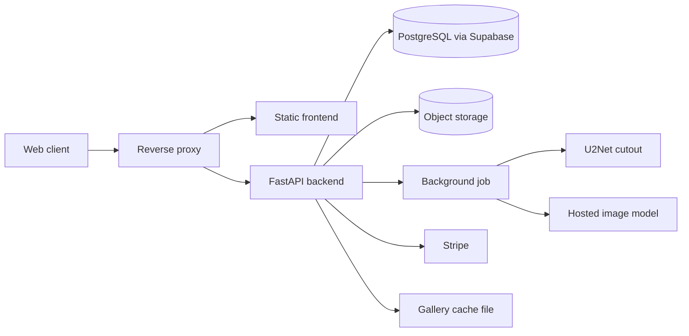

# Architecture

Design level only. No hostnames, bucket names or keys are included.

## Components

- Frontend: single page React app. Pages for home, how it works, pricing, dashboard, account, checkout, FAQ and an admin view.
- Backend: FastAPI app split into route modules for auth, images, billing, payments, users, tokens and admin.
- Auth: email and password with email OTP verification, Google sign-in, JWT access and refresh tokens, a separate admin login.
- Credits: each generation and each edit costs a fixed number of credits. Subscribers can have unlimited use.
- Payments: Stripe checkout for plans and credit packs, a billing portal, and a pay-to-unlock flow for anonymous results.
- Background removal: U2Net weights are loaded once and held in memory between requests.
- Generation: one call to a hosted image model with a fixed constraint prompt per category, square 2K output (1K for anonymous requests), temperature 0.8.
- Storage: originals and results go to object storage. A small in-memory cache with a short TTL speeds repeated reads.
- Gallery cache: the admin gallery reads a pre-built JSON file. A background loop rebuilds it every 5 minutes, so the page does not scan the bucket on each request.

## Data flow

1. Upload. The file type is checked and large images are resized to a maximum side of 2048 pixels.
2. Tier check. Anonymous users get a locked, watermarked preview. Registered users spend credits. Subscribers bypass the credit check.
3. Job. The request returns an id. The client polls a status route.
4. Pipeline. Order depends on whether a background was requested (U2Net then generation, or generation then U2Net).
5. Result. Stored, linked to the user, and shown in their image history.
6. Unlock. Anonymous results can be unlocked by payment or by credits.

## Operational notes from the source

- Containers run behind a reverse proxy that terminates TLS.
- Security headers are set by a middleware.
- Email verification and password reset codes are rate limited per address.
- The backend logs to a mounted log folder.

## Research pipeline (from the case study)

SegFormer isolates the product, ControlNet gives edge and depth priors, InstructPix2Pix applies garment edits, SDXL builds backgrounds, Real-ESRGAN upscales. Requests were routed by edit type after an A/B test. Prompt and image pairs were cached in Redis. See https://digitb.tech/case-study/chimera-studio/.
